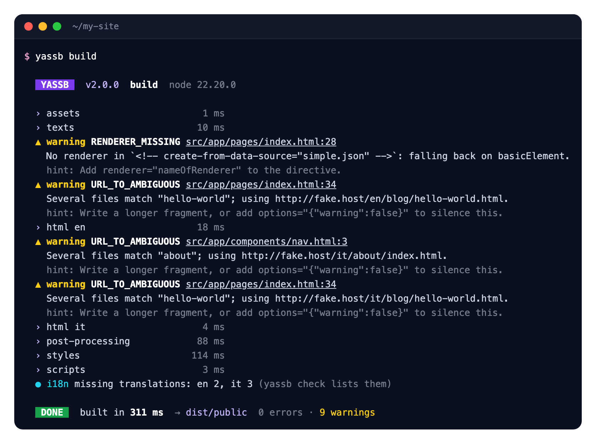
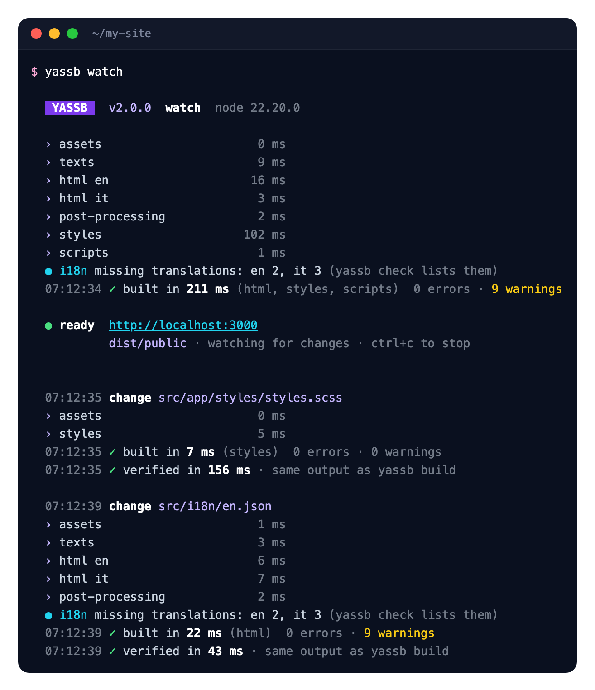
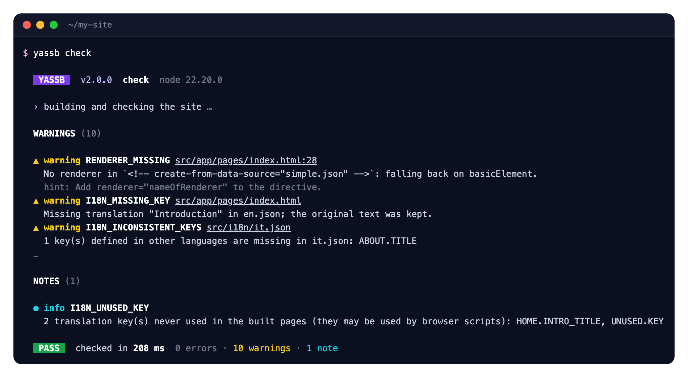
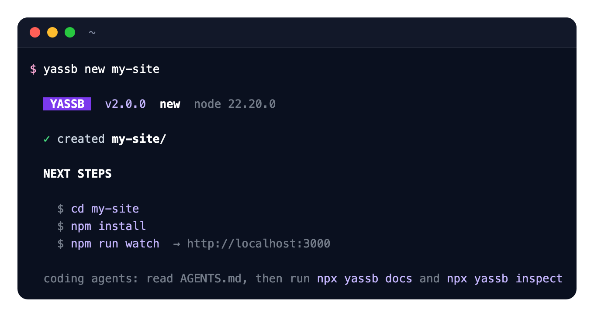
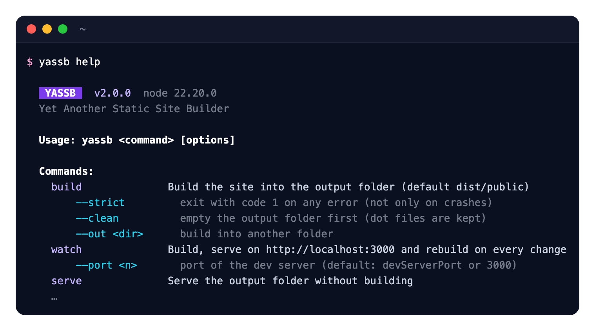

[](https://www.npmjs.com/package/yassb-web)
[](https://www.npmjs.com/package/yassb-web)
[](https://www.npmjs.com/package/yassb-web)
[](https://yassb-foss.github.io)

# YASSB (*Yet Another Static Site Builder*)

**Website and documentation: [yassb-foss.github.io](https://yassb-foss.github.io)**

YASSB builds static websites from HTML pages and components, JSON data, Markdown and translation files.

- **Data** lives in JSON (and Markdown): records, texts, dates.
- **UI** lives in HTML: pages include components and declare which data they show, with directives written as
  HTML comments — `<!-- create-from-data-source="news.json" renderer="newsList" -->`.
- **Logic** lives in TypeScript: renderers turn data into HTML.

This split makes sites easy to change by hand and by coding agents, which can discover a site with
`yassb inspect` and verify their changes with `yassb check`.

Features: components, data-driven blocks, pages generated from Markdown with front matter, multi-language sites
(`data-t` translation keys), Sass or any CSS pipeline (e.g. Tailwind), TypeScript/JSX browser scripts bundled
with esbuild, a dev server with live reload and an in-browser error overlay.

Five runtime dependencies. Runs on Node.js 20+ and Bun.

## Quick start

```bash
npx yassb-web new my-site
cd my-site
npm install
npm run watch        # http://localhost:3000
```

## In the terminal

`yassb build`: every step with its duration, problems with file and line, a summary.



`yassb watch`: serves the site with live reload and rebuilds only what a change needs, then verifies the warm
build against a clean one.



`yassb check`: builds and validates the site; exit code 1 on errors.



`yassb new` and `yassb help`:




## Commands

| Command | What it does |
|---|---|
| `yassb build` | Production build into `dist/public`. `--strict`, `--clean`, `--out <dir>`, `--json`. |
| `yassb watch` | Build, serve with live reload, rebuild on every change (config and code included). |
| `yassb serve` | Serve the output without building. |
| `yassb new <name>` | Create a project. |
| `yassb inspect [query]` | What the site is made of (pages, components, data, renderers, directives, translations), with file:line. `--json`. |
| `yassb check` | Build and validate (directives, data, translations, links, dependencies). Exit code 1 on errors. |
| `yassb docs [topic]` | The complete guide, offline. |

## A page

```html
<!-- src/app/pages/index.html -->
<!DOCTYPE html>
<html>
<head>
  <!-- component="head.html" -->
</head>
<body>
  <h1 data-t="HOME.TITLE">Welcome</h1>
  <ul>
    <!-- create-from-data-source="news.json" renderer="newsList" options="{"limit":3}" -->
  </ul>
</body>
</html>
```

```ts
// builder/renderers.ts, registered in config/default.ts as customRenderers: { newsList }
import { RendererProps } from 'yassb-web';

export function newsList({ source, options }: RendererProps<Array<{ title: string }>, { limit?: number }>): string {
  return source.slice(0, options?.limit).map(item => `<li>${item.title}</li>`).join('');
}
```

## Documentation

- [`docs/guide.md`](docs/guide.md) — the complete guide (also `yassb docs`): structure, pipeline, directives,
  renderers, custom directives, i18n, configuration, watch mode, diagnostics, architecture rules, recipes.
- [Documentation on the website](https://yassb-foss.github.io/docs/) and [llms.txt](https://yassb-foss.github.io/llms.txt).
- Upgrading from 1.x: sites keep working unchanged; see the "Upgrading from 1.x" section of the guide.

## Development

```bash
bun install
bun run test        # compile (tsc → dist/) and run the tests
bun run typecheck
```

Read [`AGENTS.md`](AGENTS.md) first: map of the code, compatibility contract, conventions.
The project website in `landing/` is itself a YASSB site: `cd landing && bun install && bun run build`.

## License

MIT
